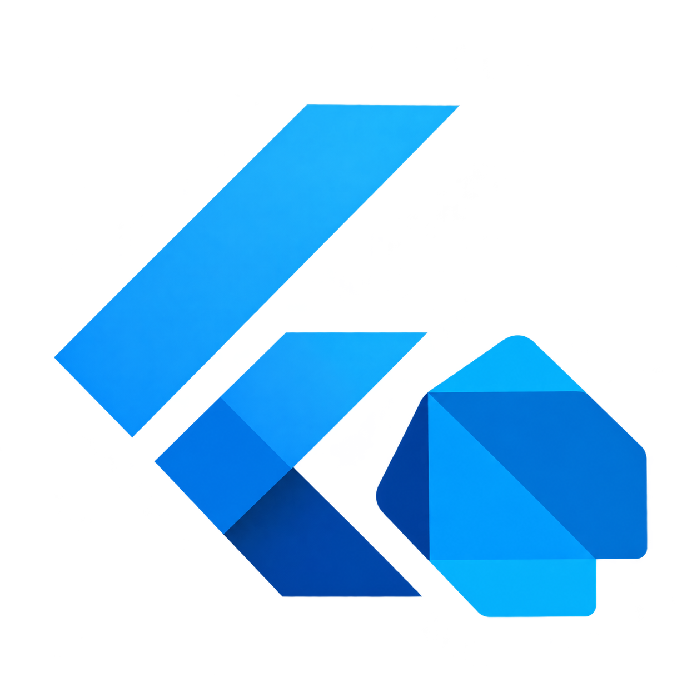

<p align="center">
  
</p>

<h1 align="center">flutter_fiber</h1>

<p align="center">
  <b>Native, declarative 3D for Flutter.</b><br>
  Build 3D scenes the way you build widget trees: procedural shapes from Dart parameters, PBR materials, lights, image/text/live-widget textures, and glTF/GLB models, rendered directly against OpenGL ES. Inspired by <a href="https://github.com/pmndrs/react-three-fiber">react-three-fiber</a>. No WebView. No bundled engine.
</p>

<p align="center">
  <i>Logo built from the official Flutter and Dart brand marks to indicate framework compatibility. flutter_fiber is an independent, unofficial package and is not affiliated with or endorsed by Google, Flutter, or Dart.</i>
</p>

---

## Contents

- [What this is](#what-this-is)
- [Install](#install)
- [Quick start](#quick-start)
- [Core concepts](#core-concepts)
- [Fiber3DCanvas](#fiber3dcanvas)
- [Camera and orbit controls](#camera-and-orbit-controls)
- [Lights](#lights)
- [Materials](#materials)
- [Textures](#textures)
- [Vertex colors](#vertex-colors)
- [Environment reflections and tone mapping](#environment-reflections-and-tone-mapping)
- [Transparency](#transparency)
- [Geometry reference](#geometry-reference)
- [Shape gallery](#shape-gallery)
- [Groups and transforms](#groups-and-transforms)
- [Interaction](#interaction)
- [Loading glTF / GLB models](#loading-gltf--glb-models)
- [Lifecycle](#lifecycle)
- [Troubleshooting](#troubleshooting)
- [Known limitations](#known-limitations)
- [Roadmap](#roadmap)
- [Credits](#credits)
- [License](#license)

---

## What this is

flutter_fiber puts a real 3D renderer inside a normal Flutter widget tree. You describe a scene with widgets (`Fiber3DCanvas`, `Fiber3DMesh`, `Fiber3DGroup`), and the package compiles the shaders, uploads the buffers and draws the frame itself.

There are two ways to get content into a scene:

- **Procedural shapes.** 22 built-in shapes (boxes, spheres, tori, polyhedra, springs, stars, lathe-revolved profiles, arrows and more) generated from Dart parameters. Because a shape is just code, it can be driven by your app's state like any other widget.
- **Loaded models.** `.glb` files and `.gltf` files with embedded data load into the same renderer through `Fiber3DGltfLoader`.

On top of that you get:

- A physically based material (`Fiber3DStandardMaterial`) with roughness, metalness, clearcoat, opacity, and image textures, plus simpler Lambert, Phong, Toon, Matcap and Basic materials.
- Ambient, point and hemisphere lights, environment reflections, tone mapping and sRGB color management.
- Textures from images, from rasterized text, and from **any live Flutter widget** (for example a Lottie animation) captured at a chosen frame rate.
- A scene graph with groups, per-frame animation callbacks, orbit camera controls, and tap/pan/pinch interaction.
- Automatic lifecycle management: rendering pauses off-screen or in the background, stops when idle, and GPU resources are released on dispose.

Why native rather than a WebView or a bundled engine:

- **Lightweight.** A thin OpenGL ES binding plus Dart-side math. No C++ engine in your APK/IPA.
- **Full pipeline ownership.** Shader compilation, buffer upload, lighting and lifecycle are plain Dart and GLSL you can read and debug.
- **One widget tree.** 3D content and the rest of your UI share the same state, gestures and lifecycle.

---

## Install

```
flutter pub add flutter_fiber
```

Or add it manually to `pubspec.yaml`:

```yaml
dependencies:
  flutter_fiber: ^0.2.0
```

Everything in this README is available from a single import:

```dart
import 'package:flutter_fiber/flutter_fiber.dart';
```

**Platform support:** Android is the primary, fully supported platform. iOS is experimental and physical-device-only (no simulator support: Apple deprecated OpenGL ES; this mirrors the same caveat React Native's own OpenGL-based 3D libraries document).

**Required Android manifest fix (temporary, will be removed in a future release):** flutter_fiber's native OpenGL binding bundles its own small manifest, which currently conflicts with your app's `android:label`. Until this is fixed upstream, add `tools:replace="android:label"` to your `android/app/src/main/AndroidManifest.xml`'s `<application>` tag, and the `xmlns:tools` namespace to the root `<manifest>` tag:

```xml
<manifest xmlns:android="http://schemas.android.com/apk/res/android"
    xmlns:tools="http://schemas.android.com/tools">
    <application
        android:label="your_app_name"
        android:name="${applicationName}"
        android:icon="@mipmap/ic_launcher"
        tools:replace="android:label">
        <!-- ...rest of your existing <application> content stays unchanged... -->
    </application>
</manifest>
```

Without this, the build fails with a manifest merge error (`Attribute application@label value=(...) is also present at [com.futouapp:threeegl...]`).

---

## Quick start

A complete, working scene. Copy it into a fresh Flutter project's `main.dart` and run it:

```dart
import 'package:flutter/material.dart';
import 'package:flutter_fiber/flutter_fiber.dart';

void main() => runApp(const MyApp());

class MyApp extends StatelessWidget {
  const MyApp({super.key});

  @override
  Widget build(BuildContext context) {
    return MaterialApp(
      home: Scaffold(
        appBar: AppBar(title: const Text('flutter_fiber')),
        body: Fiber3DCanvas(
          backgroundColor: 0x1e1e1e,
          camera: Fiber3DCamera(
            position: const Fiber3DVector3(0, 0, 5),
            target: const Fiber3DVector3.zero(),
          ),
          orbitEnabled: true, // drag to orbit, two-finger pinch to zoom
          lights: const [
            Fiber3DAmbientLight(color: 0xffffff, intensity: 0.6),
            Fiber3DPointLight(
              color: 0xffffff,
              intensity: 3.0,
              position: Fiber3DVector3(3, 4, 5),
            ),
          ],
          children: [
            Fiber3DMesh(
              geometry: Fiber3DTorusKnot(radius: 1.0, tube: 0.3),
              material: Fiber3DStandardMaterial(
                color: 0x3366ff,
                roughness: 0.5,
                metalness: 0.2,
              ),
              showEdges: false, // see "Fiber3DMesh" below: edges are ON by default
              onFrame: (elapsed, delta, transform) {
                final t = delta.inMicroseconds / 1e6;
                transform.rotation.y += t;
                transform.rotation.x += t * 0.4;
              },
            ),
          ],
        ),
      ),
    );
  }
}
```

A lit, shaded, animated, orbit-controllable 3D object in a handful of lines.

> `Fiber3DStandardMaterial` cannot be used in a `const` expression. The simpler materials (`Fiber3DBasicMaterial`, `Fiber3DLambertMaterial`, `Fiber3DPhongMaterial`, `Fiber3DToonMaterial`, `Fiber3DMatcapMaterial`) and all lights can.

---

## Core concepts

| Piece | What it is |
|---|---|
| `Fiber3DCanvas` | The root widget. It owns the OpenGL context, camera, lights and render loop. Everything 3D goes in its `children`. |
| `Fiber3DMesh` | One geometry plus one material, drawn as one object. |
| `Fiber3DGroup` | A transform node with no geometry. Moves, rotates and scales its children together. Groups can nest. |
| Geometry | A plain Dart object (`Fiber3DBox`, `Fiber3DSphere`, ...) holding `positions`, `normals`, `uvs`, optional `colors`, and `indices`. |
| Material | A plain Dart object describing the surface (`Fiber3DStandardMaterial`, ...). |
| `onFrame` | A per-frame callback on meshes and groups: `(Duration elapsed, Duration delta, Fiber3DObject transform)`. |
| `Fiber3DObject` | A transform: `position`, `rotation` (Euler, radians), `scale`, `quaternion`. Handed to you in `onFrame`. |

**Placing objects.** `Fiber3DMesh` and `Fiber3DGroup` have no `position`, `rotation` or `scale` parameters. You place and animate them through the `transform` passed to `onFrame`:

```dart
Fiber3DMesh(
  geometry: Fiber3DSphere(radius: 0.5),
  material: Fiber3DStandardMaterial(color: 0xff8800),
  onFrame: (elapsed, delta, transform) {
    transform.position.set(1.5, 0, 0); // fine to set every frame
  },
)
```

**The render loop.** The canvas renders continuously while at least one mesh or group has an `onFrame` callback registered, or while a gesture is in progress. When none does, it draws and then stops its ticker completely, and wakes on the next touch, the next `onFrame` registration, or when the app/canvas becomes visible again. Two practical consequences:

- A scene with no `onFrame` anywhere is drawn once (plus redraws during gestures). Anything that changes later without a gesture (a texture finishing decoding, a live texture updating) needs a mesh with an `onFrame` (an empty one is enough) to keep the loop running.
- Position every static object with an `onFrame` as shown above, which also keeps the loop alive.

**What updates live and what does not.**

| Change | Takes effect |
|---|---|
| Mesh `material` (any property) | Immediately, read every frame. |
| Canvas `lights`, `backgroundColor`, `toneMappingExposure` | Immediately, read every frame. |
| Mesh `geometry` | **Not after the first frame.** Geometry is uploaded to the GPU once per mesh. To change the shape, give the mesh a new `Key` (for example `ValueKey(index)`) so a fresh mesh is created. |
| Canvas `camera`, `toneMapping`, `colorManagement`, `envMapRadiance`, `envMapSize`, `envMapSamples` | Read once when the canvas is created. Give the canvas a new `Key` to apply new values. |

**Colors** are `int`s in `0xRRGGBB` form. With `colorManagement: true` (the default) they are treated as sRGB, lit in linear space, and encoded back to sRGB for display.

---

## Fiber3DCanvas

```dart
Fiber3DCanvas(
  backgroundColor: 0x1a1a1a,
  camera: Fiber3DCamera(position: const Fiber3DVector3(0, 0, 6)),
  orbitEnabled: true,
  toneMapping: Fiber3DToneMapping.acesFilmic,
  lights: const [Fiber3DAmbientLight(intensity: 0.3)],
  children: [ /* meshes, groups, models */ ],
)
```

| Parameter | Type | Default | Description |
|---|---|---|---|
| `children` | `List<Widget>` | `[]` | Meshes, groups, `Fiber3DGltfModel`, `Fiber3DArrow`, `Fiber3DWidgetTexture`. |
| `lights` | `List<dynamic>` | `[]` | `Fiber3DAmbientLight`, `Fiber3DPointLight`, `Fiber3DHemisphereLight`. See [Lights](#lights). |
| `camera` | `Fiber3DCamera` | `Fiber3DCamera()` | Initial camera. Read once at creation. |
| `orbitEnabled` | `bool` | `false` | Drag to orbit, two-finger pinch to zoom, when the gesture does not start on an interactive mesh. |
| `backgroundColor` | `int` | `0xFFFFFF` | Clear color, `0xRRGGBB`. |
| `colorManagement` | `bool` | `true` | sRGB-to-linear conversion for colors and base-color textures; output is encoded back to sRGB. `false` skips the conversions. |
| `toneMapping` | `Fiber3DToneMapping` | `none` | Tone-mapping operator. See [Environment reflections and tone mapping](#environment-reflections-and-tone-mapping). |
| `toneMappingExposure` | `double` | `1.0` | Brightness multiplier used by tone mapping (applied when `toneMapping` is not `none`). |
| `envMapRadiance` | `Fiber3DRadianceFunction?` | `Fiber3DProceduralSky().radiance` | Source of the environment used for reflections. |
| `envMapSize` | `int` | `128` | Face size of the generated environment cube map. |
| `envMapSamples` | `int` | `32` | Importance-sample count when prefiltering the environment. |

### Fiber3DMesh

| Parameter | Type | Default | Description |
|---|---|---|---|
| `geometry` | geometry object | required | Any geometry class from [Geometry reference](#geometry-reference) (or a `Fiber3DGltfPrimitive`). |
| `material` | material object | required | One material per mesh. |
| `onFrame` | `void Function(Duration elapsed, Duration delta, Fiber3DObject transform)?` | `null` | Per-frame callback. |
| `showEdges` | `bool` | **`true`** | Draws a second, unlit wireframe pass over the shaded surface. Pass `false` for a clean look. Ignored if the material's `wireframe` is already `true`. |
| `onTap` | `VoidCallback?` | `null` | See [Interaction](#interaction). |
| `onPan` | `void Function(Offset delta)?` | `null` | |
| `onPinch` | `void Function(double scale)?` | `null` | |
| `hitRadius` | `double` | `1.0` | Radius of the bounding sphere used for hit-testing. |
| `enablePinchScale` | `bool` | `false` | Built-in two-finger pinch-to-scale. |
| `minPinchScale` / `maxPinchScale` | `double` | `0.3` / `3.0` | Clamp for pinch-to-scale. |

`Fiber3DMesh` takes `geometry` and `material` as `dynamic`; passing something that is not a flutter_fiber geometry/material will not render.

---

## Camera and orbit controls

```dart
Fiber3DCamera(
  fov: 50,
  near: 0.1,
  far: 2000,
  position: const Fiber3DVector3(0, 0, 5),
  target: const Fiber3DVector3.zero(),
  up: const Fiber3DVector3(0, 1, 0),
)
```

| Parameter | Default | Description |
|---|---|---|
| `fov` | `50` | Vertical field of view, in degrees. |
| `aspect` | `1` | Leave at the default: the canvas renders with its own width/height. |
| `near` / `far` | `0.1` / `2000` | Clipping planes. |
| `position` | `(0, 0, 5)` | World position. |
| `target` | `(0, 0, 0)` | The point the camera looks at. |
| `up` | `(0, 1, 0)` | Up direction. |

`Fiber3DVector3` is an immutable `(x, y, z)` value: `const Fiber3DVector3(1, 2, 3)`, `const Fiber3DVector3.zero()`, `Fiber3DVector3.all(v)`, and a `length` getter.

With `orbitEnabled: true`, dragging orbits the camera and a two-finger pinch zooms. Orbiting pivots around the scene origin `(0, 0, 0)`. A drag that starts on a mesh that handles gestures (`onTap`, `onPan`, `onPinch` or `enablePinchScale`) goes to that mesh instead.

---

## Lights

Pass lights to `Fiber3DCanvas.lights`. Lights are canvas-level and positioned in world space; they are not part of the scene graph, so groups do not move them.

```dart
lights: const [
  Fiber3DAmbientLight(color: 0xffffff, intensity: 0.4),
  Fiber3DPointLight(color: 0xfff4e8, intensity: 3.0, position: Fiber3DVector3(4, 5, 6)),
  Fiber3DHemisphereLight(skyColor: 0x88aaff, groundColor: 0x443322, intensity: 1.0),
],
```

| Light | Parameters (default) | Notes |
|---|---|---|
| `Fiber3DAmbientLight` | `color` (`0xffffff`), `intensity` (`1.0`) | Flat, uniform light on every surface. Multiple ambient lights add together. |
| `Fiber3DPointLight` | `color` (`0xffffff`), `intensity` (`1.0`, candela), `distance` (`0` = unlimited), `decay` (`2`), `position` (`(0,0,0)`) | Emits in all directions from a point. `decay: 2` is physically correct. Up to **4** point lights are used; extras are ignored. No shadows. |
| `Fiber3DHemisphereLight` | `skyColor` (`0xffffff`), `groundColor` (`0x444444`), `intensity` (`1.0`), `direction` (`(0,1,0)`) | Blends between sky and ground color by how much a surface faces `direction`. No position, no falloff. Only the first hemisphere light is used, and it affects `Fiber3DStandardMaterial` only. Pass a normalized `direction`. |

Lambert, Phong, Toon and Standard materials respond to lights. `Fiber3DBasicMaterial` ignores them. `Fiber3DMatcapMaterial` does not use scene lights.

---

## Materials

Colors are `0xRRGGBB` ints. One material per mesh.

| Material | Lighting | `const`? | Use for |
|---|---|---|---|
| `Fiber3DStandardMaterial` | Physically based (roughness/metalness) with environment reflections | No | Realistic surfaces, glass, metals, textured objects, glTF models |
| `Fiber3DLambertMaterial` | Matte diffuse only | Yes | Cheap, non-shiny surfaces |
| `Fiber3DPhongMaterial` | Diffuse + Blinn-Phong highlight | Yes | Classic glossy highlight |
| `Fiber3DToonMaterial` | Stepped (cel-shaded) bands | Yes | Cartoon look |
| `Fiber3DMatcapMaterial` | Shading from the view-space normal, no scene lights | Yes | Stylized, lighting-independent look |
| `Fiber3DBasicMaterial` | None: always its flat color | Yes | Unlit markers, helpers |

### Fiber3DStandardMaterial

```dart
Fiber3DStandardMaterial(
  color: 0xffffff,
  roughness: 0.06,
  metalness: 1.0,
  clearcoat: 1.0,
  clearcoatRoughness: 0.03,
)
```

| Parameter | Default | Description |
|---|---|---|
| `color` | `0xffffff` | Base color. Multiplies `map` and vertex colors, so use white to show a texture untinted. |
| `roughness` | `1.0` | `0` = mirror-smooth, `1` = fully diffuse. |
| `metalness` | `0.0` | `0` = non-metal, `1` = metal. |
| `emissive` | `0x000000` | Self-lit color, unaffected by lighting. |
| `emissiveIntensity` | `1.0` | Multiplier for `emissive`. |
| `wireframe` | `false` | Lines only, no filled triangles. |
| `flatShading` | `false` | One normal per triangle (faceted look) instead of smooth per-vertex normals. |
| `map` | `null` | Base color texture (`Fiber3DTexture`). Treated as sRGB when `colorManagement` is on. |
| `roughnessMap` | `null` | Multiplies `roughness`; read from the texture's green channel. |
| `metalnessMap` | `null` | Multiplies `metalness`; read from the texture's blue channel (the same packed layout glTF uses, so one combined texture can be assigned to both). |
| `envMapIntensity` | `1.0` | Scales the environment reflection contribution. |
| `clearcoat` | `0.0` | Strength of a thin glossy lacquer layer. `1.0` = full. |
| `clearcoatRoughness` | `0.0` | Roughness of the clearcoat layer itself. |
| `opacity` | `1.0` | Alpha, used only when `transparent` is `true`. |
| `transparent` | `false` | Enables alpha blending. See [Transparency](#transparency). |

### Fiber3DLambertMaterial

`color` (`0xffffff`), `emissive` (`0x000000`), `emissiveIntensity` (`1.0`), `wireframe` (`false`), `flatShading` (`false`).

### Fiber3DPhongMaterial

Everything in Lambert, plus `specular` (`0x111111`, highlight color) and `shininess` (`30.0`; higher = smaller, sharper highlight).

### Fiber3DToonMaterial

`color`, `emissive`, `emissiveIntensity`, `wireframe`, `flatShading` (same defaults as Lambert). Direct light is stepped into discrete bands. There is no specular term and no gradient-map option yet.

### Fiber3DMatcapMaterial

`color` (`0xffffff`), `wireframe` (`false`), `flatShading` (`false`). Shading comes from the view-space normal; custom matcap textures are not supported yet.

### Fiber3DBasicMaterial

`color` (`0xffffff`), `wireframe` (`false`). Always renders its flat color, regardless of lights.

> Only `Fiber3DStandardMaterial` supports textures and transparency. The other materials render fully opaque.

---

## Textures

Textures apply through `Fiber3DStandardMaterial.map` (and `roughnessMap` / `metalnessMap`). They use the geometry's UV set, linear filtering, clamp-to-edge wrapping, and no mipmaps.

### Image textures

flutter_fiber takes raw image bytes from wherever you get them (assets, files, network). Decoding uses Flutter's own codec, so there is no extra dependency. Decoding is asynchronous: wait for it before using the texture.

```dart
final data = await rootBundle.load('assets/images/logo.png');
final bytes = data.buffer.asUint8List(data.offsetInBytes, data.lengthInBytes);

final texture = Fiber3DTexture(bytes);
await texture.ensureDecoded(); // texture.isReady is now true

// later, in the scene:
Fiber3DMesh(
  geometry: Fiber3DBox(width: 1.4, height: 1.4, depth: 1.4),
  material: Fiber3DStandardMaterial(color: 0xffffff, map: texture),
  showEdges: false,
  onFrame: (elapsed, delta, transform) {
    transform.rotation.y += delta.inMicroseconds / 1e6;
  },
)
```

Declare the image under `flutter: assets:` in your app's `pubspec.yaml`.

`Fiber3DTexture` members: `Fiber3DTexture(Uint8List bytes)`, `Fiber3DTexture.raw(Uint8List rgbaPixels, int width, int height)`, `isReady`, `pixels`, `width`, `height`, `ensureDecoded()`, `setPixels(pixels, width, height)`, and `needsUpdate`.

### Text textures

`Fiber3DTextTexture.render` rasterizes a string once into a ready-to-use texture:

```dart
final texture = await Fiber3DTextTexture.render(
  text: 'Hello',
  fontSize: 64,
  color: const Color(0xFFFFFFFF),
  backgroundColor: const Color(0xFF3366FF),
);
```

| Parameter | Default | Description |
|---|---|---|
| `text` | required | The string to draw. |
| `fontSize` | `48` | Logical font size. |
| `color` | white | Text color (`dart:ui` `Color`). |
| `backgroundColor` | transparent | Fill behind the text. |
| `fontFamily` | `null` | Optional font family. |
| `fontWeight` | `FontWeight.normal` | |
| `textAlign` | `TextAlign.center` | |
| `padding` | `16` | Logical padding around the text. |
| `pixelRatio` | `2.0` | Rasterization scale. Higher = sharper. |

The texture's size follows the text plus padding (`texture.width`, `texture.height`), so size the surface you map it on (for example a `Fiber3DPlane`) with a matching aspect ratio to avoid stretching.

### Live widget textures

`Fiber3DWidgetTexture` renders any Flutter widget off-screen and copies it into a texture at a chosen frame rate. This is how you put a Lottie animation, a video player, a chart or an animated counter on a 3D surface. It adds no dependency of its own: your app brings whichever package produces the widget.

Place it among the canvas's `children`, and keep the render loop running with an `onFrame` on a mesh that uses the texture:

```dart
final texture = Fiber3DTexture.raw(
  Uint8List.fromList([255, 255, 255, 255]), 1, 1, // placeholder until the first capture
);

Fiber3DCanvas(
  children: [
    Fiber3DWidgetTexture(
      texture: texture,
      width: 256,
      height: 256,
      fps: 30,
      child: const ColoredBox(
        color: Colors.indigo,
        child: Center(child: CircularProgressIndicator()),
      ),
    ),
    Fiber3DMesh(
      geometry: Fiber3DPlane(width: 2, height: 2),
      material: Fiber3DStandardMaterial(color: 0xffffff, map: texture),
      showEdges: false,
      onFrame: (elapsed, delta, transform) {}, // keeps the render loop running
    ),
  ],
)
```

| Parameter | Default | Description |
|---|---|---|
| `child` | required | The widget to capture. |
| `texture` | required | The `Fiber3DTexture` to update. |
| `width` / `height` | `256` / `256` | Off-screen render size in logical pixels. Larger = sharper, slower. |
| `fps` | `30` | Capture rate, independent of the child's own animation rate. |

(`dart:typed_data` provides `Uint8List`.) For text that never changes, prefer `Fiber3DTextTexture`: one rasterization, no per-frame cost.

---

## Vertex colors

Every geometry has an optional `colors` list: three doubles (r, g, b in 0..1) per vertex. When set, it multiplies the material color per vertex; when `null`, the mesh renders with the material color alone.

`Fiber3DBox` builds its faces in the order +X, -X, +Y, -Y, +Z, -Z with 4 vertices per face (at the default single segment), so one color per face looks like this:

```dart
final box = Fiber3DBox(width: 1.4, height: 1.4, depth: 1.4);

const faceColors = [
  [1.0, 0.2, 0.2], // +X
  [0.2, 1.0, 0.2], // -X
  [0.2, 0.2, 1.0], // +Y
  [1.0, 1.0, 0.2], // -Y
  [1.0, 0.2, 1.0], // +Z
  [0.2, 1.0, 1.0], // -Z
];

box.colors = [
  for (final c in faceColors)
    for (var i = 0; i < 4; i++) ...c,
];

// mesh: Fiber3DMesh(geometry: box, material: Fiber3DStandardMaterial(color: 0xffffff), ...)
```

Create the geometry once (for example in `initState`) rather than inside `build`, and set `colors` before the mesh first renders: geometry is uploaded to the GPU once per mesh.

---

## Environment reflections and tone mapping

`Fiber3DStandardMaterial` reflects an environment generated from a **radiance function**. By default that is a built-in procedural sky. The environment is built once when the canvas is created.

```dart
Fiber3DCanvas(
  toneMapping: Fiber3DToneMapping.acesFilmic,
  toneMappingExposure: 1.1,
  envMapSize: 256,      // sharper reflections, slower start-up
  envMapSamples: 64,    // smoother blurred (rough) reflections
  envMapRadiance: Fiber3DProceduralSky(
    skyColor: const [0.55, 0.7, 0.95],
    horizonColor: const [0.85, 0.85, 0.88],
    groundColor: const [0.25, 0.24, 0.26],
    sunDirection: const [0.4, 0.7, 0.4],
    sunColor: const [6.0, 5.6, 5.0],
  ).radiance,
  // ...
)
```

`Fiber3DProceduralSky` parameters (colors are linear radiance as `[r, g, b]`, and may exceed 1.0):

| Parameter | Default | Description |
|---|---|---|
| `skyColor` | `[0.4, 0.6, 0.9]` | Radiance straight up. |
| `horizonColor` | `[0.7, 0.75, 0.8]` | Radiance at the horizon. |
| `groundColor` | `[0.2, 0.2, 0.2]` | Radiance straight down. |
| `sunDirection` | `[0.3, 0.6, 0.5]` | Direction toward the sun disc (normalized internally). `null` disables the sun. |
| `sunColor` | `[8.0, 7.5, 6.5]` | Sun disc radiance. |
| `sunCosAngle` | `0.999` | Cosine of the sun disc's angular radius; closer to 1 = smaller, sharper. |

`Fiber3DCheckerboardSky` (`columns` 16, `rows` 8, `lightColor`, `darkColor`) is a high-contrast black/white pattern that makes roughness-dependent reflection blur easy to see. Both classes expose a `radiance` method with the signature `(x, y, z, out)` accepted by `envMapRadiance`; you can supply your own function of the same shape.

Per-material control: `Fiber3DStandardMaterial.envMapIntensity`. Loading an HDR image as the environment is not supported yet.

### Tone mapping

| `Fiber3DToneMapping` | Description |
|---|---|
| `none` | No tone mapping (default). |
| `linear` | Exposure only. |
| `reinhard` | Reinhard. |
| `cineon` | Cineon. |
| `acesFilmic` | ACES filmic curve, a good default for lit PBR scenes. |
| `agx` | AgX, Blender's default view transform. |
| `neutral` | Neutral. |
| `custom` | Placeholder that returns the color unchanged. |

---

## Transparency

```dart
Fiber3DStandardMaterial(
  color: 0xffffff,
  roughness: 0.05,
  opacity: 0.35,
  transparent: true,
  clearcoat: 1.0,
  clearcoatRoughness: 0.02,
)
```

`transparent: true` enables alpha blending for that mesh; `opacity` is the alpha. Transparent meshes do not write depth. A single transparent surface renders correctly. There is **no depth-sorted transparent pass yet**, so several overlapping transparent meshes can show sorting artifacts.

---

## Geometry reference

All geometries are plain Dart classes. Each exposes `positions`, `normals`, `uvs`, `indices` and an optional, settable `colors`. Counts and segment parameters are clamped to sensible minimums.

### Solids

| Shape | Parameters (defaults) | Notes |
|---|---|---|
| `Fiber3DBox` | `width` 1, `height` 1, `depth` 1, `widthSegments` 1, `heightSegments` 1, `depthSegments` 1 | Centered on the origin. |
| `Fiber3DChamferedBox` | `width` 1, `height` 1, `depth` 1, `chamferAmount` 0.2 (clamped 0 to 0.95), `segments` 8 (min 2) | Box with rounded edges and corners. `0` = sharp, near `1` = blob-like. Original to flutter_fiber. |
| `Fiber3DSphere` | `radius` 1, `widthSegments` 32 (min 3), `heightSegments` 16 (min 2), `phiStart` 0, `phiLength` 2π, `thetaStart` 0, `thetaLength` π | Poles on the Y axis. Partial angles give sectors/caps. |
| `Fiber3DCylinder` | `radiusTop` 1, `radiusBottom` 1, `height` 1, `radialSegments` 32, `heightSegments` 1, `openEnded` false, `thetaStart` 0, `thetaLength` 2π | Axis along Y, centered. |
| `Fiber3DCone` | `radius` 1, `height` 1, `radialSegments` 32, `heightSegments` 1, `openEnded` false, `thetaStart` 0, `thetaLength` 2π | A cylinder with a zero top radius: apex toward +Y. |
| `Fiber3DCapsule` | `radius` 1, `height` 1, `capSegments` 4, `radialSegments` 8, `heightSegments` 1 | `height` is the straight middle section; total length is `height + 2 * radius`. Axis along Y. |
| `Fiber3DTorus` | `radius` 1, `tube` 0.4, `radialSegments` 12, `tubularSegments` 48, `arc` 2π, `thetaStart` 0, `thetaLength` 2π | Ring lies in the XY plane (axis along Z). |
| `Fiber3DTorusKnot` | `radius` 1, `tube` 0.4, `tubularSegments` 64, `radialSegments` 8, `p` 2, `q` 3 | `p` and `q` should be coprime; otherwise the result is a torus link. |
| `Fiber3DPrism` | `radius` 1, `height` 1, `sides` 6 (min 3), `thetaStart` 0 | A true N-sided prism with flat side faces (unlike a low-segment cylinder, whose sides are smooth-shaded). Axis along Y. |
| `Fiber3DWedge` | `width` 1, `height` 1, `depth` 1 | Ramp: full height at the back (-Z), tapering to flat at the front (+Z). Sits on `y = 0` (not centered vertically). Original to flutter_fiber. |
| `Fiber3DSpring` | `radius` 1, `tubeRadius` 0.15, `turns` 4, `pitch` 0.5, `radialSegments` 16, `tubularSegments` 8 | A coil rising along +Y from `y = 0`. `radialSegments` is per turn. Original to flutter_fiber. |

### Flat shapes (in the XY plane, facing +Z)

| Shape | Parameters (defaults) | Notes |
|---|---|---|
| `Fiber3DPlane` | `width` 1, `height` 1, `widthSegments` 1, `heightSegments` 1 | Good surface for textures. |
| `Fiber3DCircle` | `radius` 1, `segments` 32 (min 3), `thetaStart` 0, `thetaLength` 2π | Filled disc or pie slice. |
| `Fiber3DRing` | `innerRadius` 0.5, `outerRadius` 1, `thetaSegments` 32 (min 3), `phiSegments` 1, `thetaStart` 0, `thetaLength` 2π | Flat annulus. |
| `Fiber3DStar` | `outerRadius` 1, `innerRadius` 0.5, `points` 5 (min 3), `depth` 0 | `depth: 0` is a flat single-sided star; `depth > 0` extrudes it into a solid. A high `points` count with close radii gives a gear silhouette. |

### Polyhedra

| Shape | Parameters (defaults) | Notes |
|---|---|---|
| `Fiber3DTetrahedron` | `radius` 1, `detail` 0 | |
| `Fiber3DOctahedron` | `radius` 1, `detail` 0 | |
| `Fiber3DDodecahedron` | `radius` 1, `detail` 0 | |
| `Fiber3DIcosahedron` | `radius` 1, `detail` 0 | |
| `Fiber3DPolyhedron` | `baseVertices`, `baseIndices`, `radius` 1, `detail` 0 | Build your own from a flat `[x, y, z, ...]` vertex list and a triangle index list. |

`detail: 0` gives sharp flat faces. Higher values subdivide each face and project the result onto a sphere of `radius`, with smooth normals.

### Revolved

| Shape | Parameters (defaults) | Notes |
|---|---|---|
| `Fiber3DLathe` | `points` (a small lens profile), `segments` 12, `phiStart` 0, `phiLength` 2π | Revolves a 2D profile of `[x, y]` pairs around the Y axis: vases, bowls, baskets. `x` is the distance from the axis. A profile that returns to `x = 0` at both ends is solid; leaving an end open gives an open vessel. |

### Fiber3DArrow (a widget, not a geometry)

`Fiber3DArrow` is a ready-made cylinder shaft plus cone head, packaged as a widget. Place it directly in `children` (or inside a group); do not pass it to `Fiber3DMesh`. It points along +Y with its base at the origin.

```dart
Fiber3DArrow(
  length: 2.0,
  headLengthRatio: 0.25,
  shaftRadiusRatio: 0.35,
  headRadius: 0.2,
  radialSegments: 16,
  shaftMaterial: Fiber3DStandardMaterial(color: 0x2952cc, roughness: 0.5),
  headMaterial: Fiber3DStandardMaterial(color: 0xcc2929, roughness: 0.5),
)
```

| Parameter | Default | Description |
|---|---|---|
| `length` | `2.0` | Total length, base to tip. |
| `headLengthRatio` | `0.25` | Fraction of `length` taken by the head. |
| `shaftRadiusRatio` | `0.35` | Shaft radius as a fraction of `headRadius`. |
| `headRadius` | `0.2` | Radius of the head's base. |
| `radialSegments` | `16` | Smoothness. |
| `shaftMaterial` / `headMaterial` | grey Standard material | Must be `Fiber3DStandardMaterial`. |

---

## Shape gallery

Every procedural shape is generated live. Clone the repo and run the example app to page through them interactively, with toggles for wireframe edges and flat/smooth shading. The clips below are captured from that app.

### Box

<video src="https://github.com/user-attachments/assets/8e1a693f-2c81-47b6-a6fb-3d7d3bc94268" width="360" controls></video>

```dart
Fiber3DBox(width: 1.4, height: 1.4, depth: 1.4)
```

### Capsule

<video src="https://github.com/user-attachments/assets/4b59071b-a49e-491c-80f3-d2c899e23857" width="360" controls></video>

```dart
Fiber3DCapsule(radius: 0.6, height: 1.2)
```

### Cone

<video src="https://github.com/user-attachments/assets/b68b4793-f1fd-4be1-aaf6-c8ece8298f61" width="360" controls></video>

```dart
Fiber3DCone(radius: 1.0, height: 1.8, radialSegments: 32)
```

### Cylinder

<video src="https://github.com/user-attachments/assets/c9e0a24a-c6f8-4330-b93a-b1500c5e9e04" width="360" controls></video>

```dart
Fiber3DCylinder(radiusTop: 0.8, radiusBottom: 0.8, height: 1.8)
```

### Icosahedron

<video src="https://github.com/user-attachments/assets/e1e24a44-f776-45db-92fb-becec6c1f6f3" width="360" controls></video>

```dart
Fiber3DIcosahedron(radius: 1.2)
```

### Lathe (revolved profile)

<video src="https://github.com/user-attachments/assets/d5401988-18ec-4a5d-b11c-dcac1ab64e8d" width="360" controls></video>

```dart
Fiber3DLathe(
  points: const [
    [0.0, -0.9],
    [0.5, -0.85],
    [0.85, -0.5],
    [0.95, 0.0],
    [0.85, 0.5],
    [0.5, 0.85],
  ],
  segments: 24,
)
```

### Ring

<video src="https://github.com/user-attachments/assets/7600fe0b-d485-4d13-9651-9f6e28e46c87" width="360" controls></video>

```dart
Fiber3DRing(innerRadius: 0.5, outerRadius: 1.2)
```

### Sphere

<video src="https://github.com/user-attachments/assets/026a30f9-8059-4deb-82ff-b6cc53c5f834" width="360" controls></video>

```dart
Fiber3DSphere(radius: 1.2)
```

### Torus (donut)

<video src="https://github.com/user-attachments/assets/0d18ed35-e73a-4e68-b9fc-08560c52c887" width="360" controls></video>

```dart
Fiber3DTorus(radius: 1.0, tube: 0.4)
```

### Torus Knot

<video src="https://github.com/user-attachments/assets/1945b41d-b29d-44ee-be80-4d14144de1da" width="360" controls></video>

```dart
Fiber3DTorusKnot(radius: 1.0, tube: 0.3)
```

### More shapes

```dart
Fiber3DChamferedBox(width: 1.4, height: 1.4, depth: 1.4, chamferAmount: 0.4)
Fiber3DPrism(radius: 1.1, height: 1.6, sides: 6)
Fiber3DWedge(width: 1.5, height: 1.0, depth: 1.5)
Fiber3DSpring(radius: 0.8, tubeRadius: 0.15, turns: 4, pitch: 0.5)
Fiber3DStar(outerRadius: 1.2, innerRadius: 0.5, points: 5, depth: 0.3)
Fiber3DOctahedron(radius: 1.2)
Fiber3DTetrahedron(radius: 1.2)
Fiber3DDodecahedron(radius: 1.1)
Fiber3DCapsule(radius: 0.6, height: 1.2)
Fiber3DCircle(radius: 1.2, segments: 32)
Fiber3DPlane(width: 2, height: 2)
```

> **Note on video rendering:** these `<video>` tags render on GitHub. pub.dev's README sanitizer does not render embedded video, so on pub.dev this section shows code samples only; the clips are available in the GitHub repo.

---

## Groups and transforms

Group several meshes to move, rotate and scale them as one object:

```dart
Fiber3DGroup(
  onFrame: (elapsed, delta, transform) {
    transform.rotation.y += delta.inMicroseconds / 1e6; // spins the whole group
  },
  children: [
    Fiber3DMesh(
      geometry: Fiber3DCapsule(radius: 0.5, height: 1.5),
      material: Fiber3DStandardMaterial(color: 0x3366ff),
      showEdges: false,
      onFrame: (elapsed, delta, transform) {
        transform.position.set(0, 0.5, 0);
      },
    ),
  ],
)
```

Groups nest, and group motion and per-mesh motion compose automatically. A mesh with no `onFrame` of its own simply rides along with its parent group. The toy train below is built entirely from these shapes (the clip shows it running):

<video src="https://github.com/user-attachments/assets/7ecc1140-75af-43ff-af5a-c2e42f4d24d1" width="360" controls></video>

```dart
import 'dart:math';
import 'package:flutter/material.dart';
import 'package:flutter_fiber/flutter_fiber.dart';

void main() {
  runApp(const FiberTrainDemo());
}

class FiberTrainDemo extends StatelessWidget {
  const FiberTrainDemo({super.key});

  @override
  Widget build(BuildContext context) {
    return MaterialApp(
      debugShowCheckedModeBanner: false,
      home: Scaffold(
        appBar: AppBar(
          title: const Text('flutter_fiber toy train (composed shapes)'),
          backgroundColor: const Color(0xFF828282),
        ),
        body: Fiber3DCanvas(
          backgroundColor: 0x87ceeb,
          camera: Fiber3DCamera(
            position: const Fiber3DVector3(0, 1.0, 7),
            target: const Fiber3DVector3(0, 0.3, 0),
          ),
          orbitEnabled: true,
          lights: const [
            Fiber3DAmbientLight(color: 0xffffff, intensity: 0.7),
            Fiber3DPointLight(
              color: 0xffffff,
              intensity: 3.0,
              position: Fiber3DVector3(3, 4, 5),
            ),
            Fiber3DPointLight(
              color: 0xffffff,
              intensity: 1.2,
              position: Fiber3DVector3(-3, 2, -2),
            ),
          ],
          children: const [_ToyTrain()],
        ),
      ),
    );
  }
}

/// Cab (box) + boiler (horizontal cylinder) + chimney (nested group),
/// plus side-mounted wheels. The whole group does a slow turntable spin;
/// each wheel also spins independently about its own axle.
class _ToyTrain extends StatelessWidget {
  const _ToyTrain();

  @override
  Widget build(BuildContext context) {
    return Fiber3DGroup(
      onFrame: (elapsed, delta, transform) {
        final t = delta.inMicroseconds / 1e6;
        transform.rotation.y += t * 0.3;
      },
      children: const [
        _TrainBody(),
        _TrainBoiler(),
        _Chimney(),
        _Wheel(axleX: 1.0, radius: 0.32, side: 1),
        _Wheel(axleX: 1.0, radius: 0.32, side: -1),
        _Wheel(axleX: -0.9, radius: 0.5, side: 1),
        _Wheel(axleX: -0.9, radius: 0.5, side: -1),
        _Wheel(axleX: 0, radius: 0.32, side: 1),
        _Wheel(axleX: 0, radius: 0.32, side: -1),
      ],
    );
  }
}

class _TrainBody extends StatelessWidget {
  const _TrainBody();
  @override
  Widget build(BuildContext context) {
    return Fiber3DMesh(
      geometry: Fiber3DBox(width: 1.6, height: 1.4, depth: 1.3),
      material: Fiber3DStandardMaterial(
        color: 0xcc1111,
        roughness: 0.4,
        metalness: 0.3,
        flatShading: true,
      ),
      onFrame: (elapsed, delta, transform) {
        // The cab's bottom sits flush at y = 0, the same ground line
        // every wheel and the boiler use.
        transform.position.set(-0.9, 0.8, 0);
      },
    );
  }
}

/// The boiler: a horizontal cylinder joining the cab's front face.
class _TrainBoiler extends StatelessWidget {
  const _TrainBoiler();
  @override
  Widget build(BuildContext context) {
    return Fiber3DMesh(
      geometry: Fiber3DCylinder(
        radiusTop: 0.5,
        radiusBottom: 0.5,
        height: 2.0,
        radialSegments: 24,
      ),
      material: Fiber3DStandardMaterial(
        color: 0xcc1111,
        roughness: 0.4,
        metalness: 0.3,
        flatShading: true,
      ),
      onFrame: (elapsed, delta, transform) {
        // Rotating -90 degrees about Z lays the cylinder on its side.
        transform.rotation.z = -pi / 2;
        transform.position.set(0.6, 0.5, 0);
      },
    );
  }
}

/// The chimney: a nested group (thin cylinder + cone) on top of the boiler.
class _Chimney extends StatelessWidget {
  const _Chimney();
  @override
  Widget build(BuildContext context) {
    return Fiber3DGroup(
      children: [
        Fiber3DMesh(
          geometry: Fiber3DCylinder(
            radiusTop: 0.12,
            radiusBottom: 0.14,
            height: 0.35,
            radialSegments: 16,
          ),
          material: Fiber3DStandardMaterial(
            color: 0x1a1a1a,
            roughness: 0.5,
            metalness: 0.4,
            flatShading: true,
          ),
          onFrame: (elapsed, delta, transform) {
            transform.position.set(1.0, 1.175, 0);
          },
        ),
        Fiber3DMesh(
          geometry: Fiber3DCone(radius: 0.16, height: 0.18, radialSegments: 16),
          material: Fiber3DStandardMaterial(
            color: 0x1a1a1a,
            roughness: 0.5,
            metalness: 0.4,
            flatShading: true,
          ),
          onFrame: (elapsed, delta, transform) {
            transform.position.set(1.0, 1.44, 0);
          },
        ),
      ],
    );
  }
}

/// One side-mounted wheel: a cylinder tilted 90 degrees about X so its
/// flat faces point sideways. `side` is +1 (right) or -1 (left).
class _Wheel extends StatelessWidget {
  final double axleX;
  final double radius;
  final int side;

  const _Wheel({
    required this.axleX,
    required this.radius,
    required this.side,
  });

  @override
  Widget build(BuildContext context) {
    const wheelThickness = 0.28;
    const bodyHalfDepth = 0.5;

    return Fiber3DMesh(
      geometry: Fiber3DCylinder(
        radiusTop: radius,
        radiusBottom: radius,
        height: wheelThickness,
        radialSegments: 20,
      ),
      material: Fiber3DStandardMaterial(
        color: 0x1a3d33,
        roughness: 0.5,
        metalness: 0.3,
        flatShading: true,
      ),
      onFrame: (elapsed, delta, transform) {
        final z = side * (bodyHalfDepth + wheelThickness / 2);
        transform.position.set(axleX, radius, z); // sits on the ground line
        transform.rotation.x = pi / 2;            // fixed tilt: axis along Z

        final t = delta.inMicroseconds / 1e6;
        transform.rotation.y += t * 4;            // spin about its own axle
      },
    );
  }
}
```

### The transform (`Fiber3DObject`)

The `transform` passed to `onFrame` is a `Fiber3DObject`.

| Member | Description |
|---|---|
| `position` | Mutable vector: `position.set(x, y, z)`, `position.x += 1`. |
| `rotation` | Euler angles in radians, XYZ order. Mutable: `rotation.y += t`. |
| `scale` | Mutable vector, default `(1, 1, 1)`. |
| `quaternion` | The same rotation as a quaternion. `rotation` and `quaternion` stay in sync. |
| `pivot` | Optional point that rotation and scale are applied around instead of the origin. |
| `rotateX(angle)`, `rotateY(angle)`, `rotateZ(angle)` | Rotate in local space. |
| `translateX(d)`, `translateY(d)`, `translateZ(d)` | Move along a local axis. |
| `lookAt(target)` | Rotate to face a world-space `Fiber3DVector3`. |
| `getWorldPosition()` | The object's world position as a `Fiber3DVector3`. |
| `name`, `userData` | Free-form label and map for your own use. |

---

## Interaction

```dart
Fiber3DMesh(
  geometry: Fiber3DSphere(radius: 0.8),
  material: Fiber3DStandardMaterial(color: 0xff8800),
  hitRadius: 1.0,
  onTap: () => debugPrint('tapped'),
  onPan: (delta) => debugPrint('pan $delta'),
  enablePinchScale: true,
  minPinchScale: 0.5,
  maxPinchScale: 2.5,
)
```

- `onTap`, `onPan(Offset delta)` and `onPinch(double scale)` fire when the gesture starts on the mesh. `scale` is cumulative since the pinch began.
- `enablePinchScale: true` makes the mesh scale itself uniformly, clamped to `minPinchScale`..`maxPinchScale`.
- Hit-testing is coarse by design: a bounding sphere of radius `hitRadius` centered on the mesh's own `transform.position` (local position, not including parent group transforms). Set `hitRadius` to roughly the mesh's extent.
- Gestures that start on empty space go to the camera when `orbitEnabled` is `true`.

---

## Loading glTF / GLB models

```dart
class ModelViewer extends StatefulWidget {
  const ModelViewer({super.key});

  @override
  State<ModelViewer> createState() => _ModelViewerState();
}

class _ModelViewerState extends State<ModelViewer> {
  Fiber3DGltfScene? _scene;
  Object? _error;

  @override
  void initState() {
    super.initState();
    _load();
  }

  Future<void> _load() async {
    try {
      final data = await rootBundle.load('assets/models/car.glb');
      final bytes = data.buffer.asUint8List(data.offsetInBytes, data.lengthInBytes);
      final scene = await Fiber3DGltfLoader.loadGlb(bytes);
      if (!mounted) return;
      setState(() => _scene = scene);
    } catch (e) {
      if (!mounted) return;
      setState(() => _error = e);
    }
  }

  @override
  Widget build(BuildContext context) {
    if (_error != null) return Center(child: Text('Failed to load model:\n$_error'));
    final scene = _scene;
    if (scene == null) return const Center(child: CircularProgressIndicator());

    return Fiber3DCanvas(
      backgroundColor: 0x1a1a1a,
      toneMapping: Fiber3DToneMapping.acesFilmic,
      camera: Fiber3DCamera(
        position: const Fiber3DVector3(0, 2, 8),
        target: const Fiber3DVector3.zero(),
      ),
      orbitEnabled: true,
      lights: const [
        Fiber3DAmbientLight(color: 0xffffff, intensity: 0.3),
        Fiber3DPointLight(
          color: 0xffffff,
          intensity: 3.0,
          position: Fiber3DVector3(4, 5, 5),
        ),
        Fiber3DPointLight(
          color: 0xffffff,
          intensity: 1.5,
          position: Fiber3DVector3(-4, 2, -2),
        ),
      ],
      children: [Fiber3DGltfModel(scene: scene, scale: 1.0)],
    );
  }
}
```

Declare the model under `flutter: assets:` in your app's `pubspec.yaml`.

| API | Description |
|---|---|
| `Fiber3DGltfLoader.loadGlb(Uint8List bytes)` | Parses a binary `.glb`. Returns `Future<Fiber3DGltfScene>`. |
| `Fiber3DGltfLoader.loadEmbeddedGltf(String jsonText)` | Parses a `.gltf` whose buffers and images are all base64 data URIs. You read the file text yourself. |
| `Fiber3DGltfModel(scene:, scale:)` | Widget that adds a loaded scene to the canvas. `scale` (default `1.0`) is a uniform scale. |

**Scale and framing.** glTF files disagree on real-world units, so a model can arrive far smaller or larger than your camera expects. Use `Fiber3DGltfModel.scale` and the camera distance to frame it. To rotate or move a whole model, wrap it in a `Fiber3DGroup` and drive that group's `transform` in `onFrame`.

**Supported:**

- `.glb` and `.gltf` with embedded (data URI) buffers/images; PNG/JPEG images embedded in the file.
- The node hierarchy, with translation/rotation/scale or a single matrix per node.
- Triangle meshes with `POSITION`, `NORMAL`, `TEXCOORD_0` and float `COLOR_0` attributes, indexed or not.
- The metallic-roughness material: base color factor and texture, metallic and roughness factors, the combined metallic-roughness texture, `emissiveFactor`, and `alphaMode: "BLEND"` (as transparency).

**Not supported (yet):**

- External `.bin` or image files referenced by URI.
- Primitives with more than 65,535 vertices (the loader throws a `FormatException`).
- Non-triangle primitives (lines, points, strips, fans) are skipped. Skinning, morph targets, animations, cameras and lights in the file are ignored.
- Normal, emissive and occlusion textures; `alphaMode: "MASK"` (treated as opaque); texture wrap modes and UV transforms; normalized (non-float) vertex colors.
- `KHR_materials_clearcoat` (clearcoat factors) and `KHR_materials_emissive_strength` are read. Other `KHR_materials_*` extensions (specular, transmission and the rest) are ignored, so glass built with transmission renders as a plain alpha blend.
---

## Lifecycle

`Fiber3DCanvas` manages its own GPU and battery cost automatically:

- Rendering pauses when the canvas scrolls off-screen, and resumes when it is visible again.
- Rendering pauses when the app is backgrounded, and resumes on foreground.
- The render loop fully stops (not just throttles) once nothing is animating and no gesture is in progress, and wakes on the next `onFrame` registration or touch.
- All GPU resources (buffers, textures, shader programs, the GL context itself) are released on dispose. No manual cleanup is required.

---

## Troubleshooting

| Symptom | Likely cause |
|---|---|
| Build fails with a manifest merge error mentioning `application@label` | Add the `tools:replace="android:label"` fix from [Install](#install). |
| Every shape shows a wireframe overlay | `Fiber3DMesh.showEdges` defaults to `true`. Pass `showEdges: false`. |
| An object sits at the origin | There is no `position` parameter. Set `transform.position` in `onFrame`. |
| A texture stays white | The texture was not decoded yet and nothing kept the render loop running. `await texture.ensureDecoded()` before building the scene, or give a mesh an `onFrame`. |
| A live (widget/Lottie) texture is frozen | No mesh is keeping the render loop alive. Add an `onFrame` (even an empty one) to a mesh that uses the texture. |
| Changing `geometry` on rebuild has no effect | Geometry is uploaded once per mesh. Give the mesh a new `Key`. |
| A loaded model is invisible, tiny or huge | Adjust `Fiber3DGltfModel.scale` and the camera position. |
| `const` error on `Fiber3DStandardMaterial` | It is not a `const` constructor. Remove `const`. |

---

## Known limitations

- **One material per mesh.** Per-face or multi-material meshes are not supported; compose several meshes in a group instead.
- **16-bit indices.** A single geometry or glTF primitive is limited to 65,535 vertices.
- **No depth-sorted transparency.** Overlapping transparent meshes can show sorting artifacts.
- **Textures** use UV set 0, clamp-to-edge wrapping, linear filtering, no mipmaps and no UV transform, and only `Fiber3DStandardMaterial` accepts them. Normal, emissive and occlusion maps are not implemented. `roughnessMap` and `metalnessMap` follow the glTF packing convention but have had limited testing.
- **Lights:** ambient, point (max 4) and hemisphere (1, Standard material only). No directional or spot lights, no shadows.
- **Toon and Matcap** use built-in shading; gradient-map and matcap textures are not supported yet.
- **Environment** comes from a radiance function (procedural sky provided); loading HDR images is not supported yet.
- **Hit-testing** is a coarse bounding sphere at the mesh's local position.
- **glTF:** see the unsupported list above.
- **Platforms:** Android is the primary target; iOS is experimental and device-only.

---

## Roadmap

- **Text and logo extrusion (next).** A port of three.js's text/shape pipeline: glyph outlines and SVG-style shapes turned into real 3D geometry at runtime.
- Under consideration, in no particular order: depth-sorted transparency, multi-material meshes, matcap/gradient textures, `KHR_materials_*` glTF extensions, mipmaps and wrap modes, normal maps, HDR environment loading, glTF animation.

---

## Credits

Much of the geometry and shading code is a port of [three.js](https://github.com/mrdoob/three.js) (MIT licensed), adapted to Dart and OpenGL ES. flutter_fiber is inspired by [react-three-fiber](https://github.com/pmndrs/react-three-fiber). `Fiber3DChamferedBox`, `Fiber3DWedge`, `Fiber3DSpring`, `Fiber3DStar`, `Fiber3DPrism` and `Fiber3DArrow` are original to this package.

---

## License

MIT. Free to use, modify, and ship in commercial products. See [LICENSE](LICENSE).

---

## Author

Built by **Darwin** ([CoCoNuT-sTuDiOs](https://github.com/CoCoNuT-sTuDiOs)).